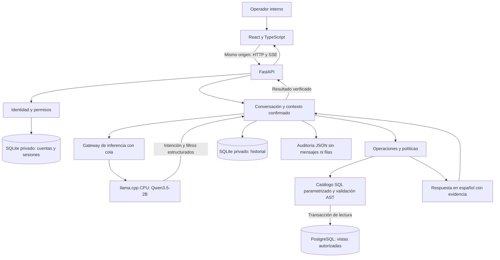
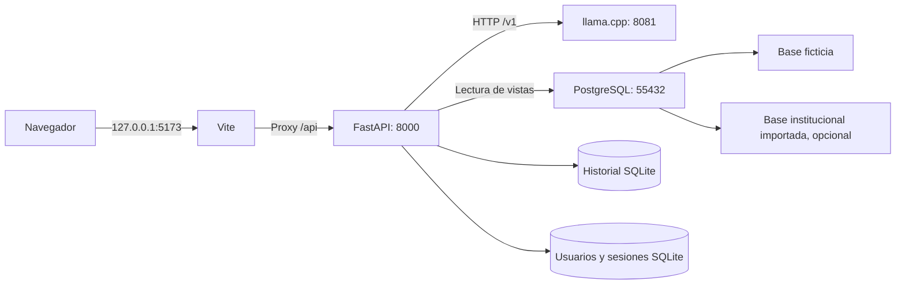
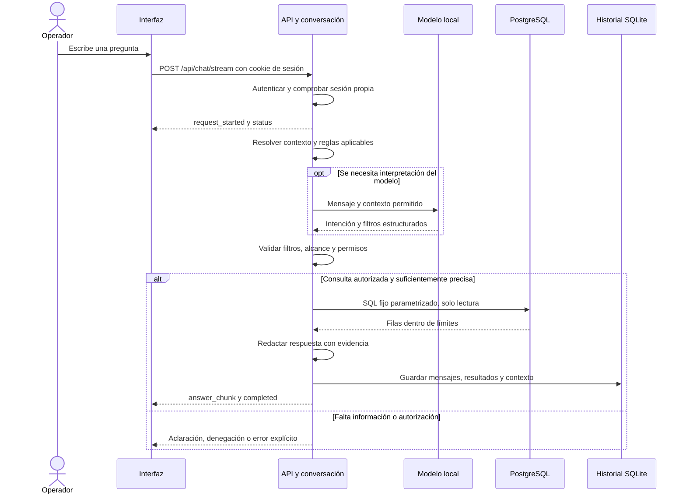
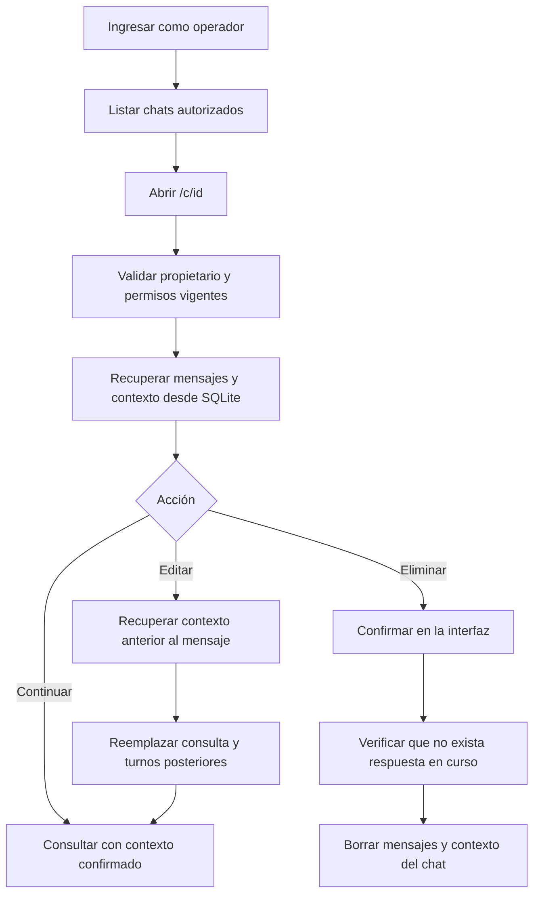
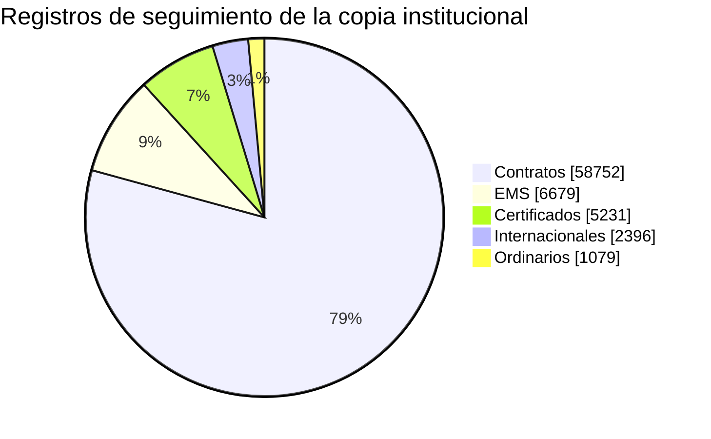
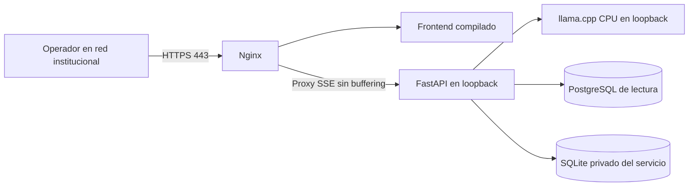

# Asistente postal · Correos Bolivia

Asistente de consulta interna para explorar seguimiento postal, sucursales, personal autorizado y resúmenes de registros mediante preguntas en español. Combina una interfaz React, una API modular FastAPI, PostgreSQL de solo lectura y un modelo local ejecutado en CPU con llama.cpp.

El modelo interpreta la intención y los filtros. El servidor valida permisos, ejecuta consultas de un catálogo cerrado y redacta la respuesta a partir de los resultados, con fuente, fecha de consulta y avisos de información parcial.

> **Estado:** implementación local validada en Windows. Hay una instalación conectada a una copia del respaldo institucional del **8 de octubre de 2026**, sin actualización en vivo. Clonar este repositorio no incluye esa base, credenciales, historial ni pesos del modelo. El entorno reproducible de inicio utiliza datos ficticios independientes. Las plantillas Linux están pendientes de validación institucional.

## Contenido

- [Funciones](#funciones)
- [Arquitectura](#arquitectura)
- [Flujos de funcionamiento](#flujos-de-funcionamiento)
- [Stack tecnológico](#stack-tecnológico)
- [Requisitos](#requisitos)
- [Instalación desde cero](#instalación-desde-cero)
- [Arranque y parada](#arranque-y-parada)
- [Usuarios y sesiones](#usuarios-y-sesiones)
- [Configuración](#configuración)
- [API y contratos](#api-y-contratos)
- [Datos y procedencia](#datos-y-procedencia)
- [Seguridad y límites](#seguridad-y-límites)
- [Estructura del repositorio](#estructura-del-repositorio)
- [Pruebas y CI](#pruebas-y-ci)
- [Despliegue y operación](#despliegue-y-operación)
- [Solución de problemas](#solución-de-problemas)
- [Alcance pendiente y documentación](#alcance-pendiente-y-documentación)

## Funciones

| Área | Comportamiento implementado |
| --- | --- |
| Acceso | Cuentas administradas con usuario y contraseña, cookie HttpOnly y cierre de sesión con revocación. |
| Seguimiento | Consulta por código exacto, estado, origen, destino y fechas registradas; un código puede corresponder a varios registros. |
| Sucursales | Directorio por departamento, fichas completas y navegación de relaciones disponibles. |
| Personal | Consultas de personal relacionado con una sucursal, sujetas a permisos de datos personales. |
| Resúmenes | Conteos por estado, familia y destino; desgloses geográficos según las correspondencias documentadas. |
| Periodos | Rangos explícitos y expresiones como «todo octubre» o «el mes pasado», con aclaración cuando falta contexto. |
| Familias postales | EMS, certificados, ordinarios, contratos e internacionales; continuaciones que conservan el periodo confirmado. |
| Registros individuales | Lista paginada por periodo y familia, con navegación siguiente/anterior y límites de tamaño. |
| Fuentes contables | Consulta separada de movimientos, cobros y registros de facturación autorizados, sin inferir moneda ni balances. |
| Conversaciones | Historial SQLite por operador, URL `/c/{id}`, búsqueda por título y recuperación tras reiniciar. |
| Edición | Reenvío de una consulta anterior recuperando su contexto y reemplazando los turnos posteriores. |
| Eliminación | Confirmación visual y borrado del chat propio; se impide mientras está respondiendo. |
| Interfaz | Tema claro/oscuro, diseño adaptable, controles de teclado y cartero animado con alternativa de movimiento reducido. |
| Respuesta progresiva | Eventos SSE de estado, respuesta verificada y cancelación de solicitudes propias. |

Ejemplos para el entorno ficticio: «Consulta el seguimiento de DEMO-CERTI-001», «¿Y su estado?», «Lista las oficinas de La Paz» y «Cuenta registros por estado desde 2026-01-01 hasta 2027-01-01, fecha final exclusiva».

Para explorar continuaciones: consultar un periodo, pedir «de EMS», «por departamentos» y después «todos los registros». La disponibilidad de cada operación depende de los datos y permisos del entorno.

## Arquitectura

### Vista general



La API es un monolito modular: se despliega como un proceso y separa responsabilidades mediante contratos y archivos `public.py`. `backend/app/bootstrap.py` compone los adaptadores de identidad, inferencia, datos, operaciones y conversación. Las pruebas comprueban las fronteras de importación y la ausencia de ciclos.

| Módulo | Responsabilidad |
| --- | --- |
| `identity` | Autenticar cuentas y sesiones del navegador, admitir Bearer para scripts y construir la identidad confiable. |
| `policies` | Comprobar permisos y alcance de las operaciones. |
| `conversation` | Coordinar consultas, contexto, historial, edición y cancelación. |
| `operations` | Ejecutar herramientas permitidas y validar sus argumentos. |
| `analytics` | Construir resúmenes y agrupaciones admitidos. |
| `data_access` | Consultar PostgreSQL y persistir historial SQLite con adaptadores separados. |
| `inference` | Interpretar mensajes mediante reglas de demostración o modelo HTTP local. |
| `answers` | Presentar resultados factuales en español. |
| `audit` | Registrar estado, operación, identidad interna, versión y duración. |

Solo `data_access/infrastructure.py` importa el driver SQL de negocio. La escritura del historial SQLite es independiente de la cuenta de lectura postal de PostgreSQL.

### Topología local



La instalación local puede alojar ambas bases en el mismo cluster. `-Fixture` selecciona explícitamente la ficticia; el arranque habitual prefiere la configuración institucional cuando existe. PostgreSQL y el modelo no se consultan directamente desde el navegador.

## Flujos de funcionamiento

### Consulta y respuesta



Los fragmentos `answer_chunk` se emiten después de verificar los resultados. El progreso temprano indica actividad; no presenta texto factual sin comprobar. Una cancelación detiene la tarea y las operaciones HTTP/SQL asíncronas asociadas.

### Historial, edición y eliminación



El UUID identifica el chat y su URL; conocerlo no concede acceso. El TTL limpia caché de memoria, no borra el historial. La edición de chats antiguos reconstruye únicamente contexto acreditado antes del mensaje editado.

## Stack tecnológico

Versiones declaradas por el proyecto; los archivos de bloqueo fijan las dependencias resueltas.

| Capa | Tecnología y versión | Uso |
| --- | --- | --- |
| Interfaz | React / React DOM `19.3.1` | Componentes, chat y navegación. |
| Lenguaje web | TypeScript `5.9.3` | Contratos y comprobación estática. |
| Herramientas web | Vite `7.3.7`, npm | Desarrollo, proxy y build. |
| API | Python `>=3.12`, FastAPI `>=0.115,<1`, Uvicorn `>=0.34,<1` | HTTP, SSE y ejecución asíncrona. |
| Configuración | Pydantic Settings `>=2.7,<3` | Validación de variables y `.env`. |
| Datos | PostgreSQL `18`, Psycopg `>=3.2,<4` con pool | Lectura asíncrona con permisos restringidos. |
| Validación SQL | SQLGlot `>=26,<31` | Comprobar estructura AST del catálogo permitido. |
| Cliente de inferencia | HTTPX `>=0.28,<1` | Comunicación con el servidor local. |
| Historial | SQLite, biblioteca estándar Python | Persistencia privada de chats. |
| Autenticación | SQLite, scrypt y cookies HttpOnly | Cuentas administradas y sesiones revocables. |
| Modelo | Qwen3.5-2B, GGUF `Q4_K_M` | Interpretación estructurada en español. |
| Runtime del modelo | llama.cpp `b11696`, CPU x64 | Una generación concurrente, sin GPU. |
| Pruebas | pytest, pytest-asyncio, unittest, Node Test Runner | Contratos, seguridad, lógica e integración. |
| Automatización | GitHub Actions | Pruebas backend/frontend, build y auditoría npm. |
| Servidor institucional | Nginx y systemd | Plantillas de HTTPS, proxy SSE y servicios Linux. |

El manifiesto [config/model-manifest.json](config/model-manifest.json) fija revisión, archivo, licencia y SHA-256 del modelo y del runtime. El modelo ocupa **1.280.835.840 bytes**; no se versiona en Git. La selección del modelo sigue siendo provisional hasta completar la evaluación de negocio.

## Requisitos

| Requisito | Condición |
| --- | --- |
| Sistema local | Windows x64 y PowerShell; los scripts de instalación usan binarios Windows. |
| Python | Python 3.12 y `uv` disponibles; `uv` puede preparar el intérprete solicitado. |
| Node.js | Node.js 22 con npm, igual que el workflow de frontend. |
| PostgreSQL | PostgreSQL 18 con `initdb`, `pg_ctl`, `psql`, `createdb` y `pg_restore`. Ruta predeterminada: `C:/Program Files/PostgreSQL/18/bin`. |
| Git | Para clonar y actualizar el proyecto. |
| Red inicial | Acceso a paquetes Python/npm y descargas fijadas del modelo/runtime. Después, las consultas usan servicios locales y los datos configurados. |
| Puertos locales | `5173`, `8000`, `8081` y `55432` disponibles. |
| Disco | Espacio para modelo, runtime, dependencias y cluster; el tamaño de una importación depende del respaldo. |
| Recursos observados | Validación exploratoria en Intel Core i5-12500H y aproximadamente 16 GB de RAM; no se ha establecido un mínimo garantizado. |
| Opcional | FFmpeg y FFprobe para reconstruir la animación; Playwright CLI y navegador para comprobaciones visuales. |

No se necesita GPU ni Docker para el entorno local documentado. El runtime arranca con 4 hilos, contexto de 4096 tokens y una generación a la vez. En mediciones exploratorias históricas el proceso del modelo llegó aproximadamente a 2 GiB de memoria de trabajo; ese dato no representa el consumo total del sistema ni una garantía de capacidad. Ver [validación](docs/validation.md).

## Instalación desde cero

### 1. Clonar y preparar dependencias

```powershell
git clone https://github.com/Eddzzz/chatbot-correos.git
Set-Location chatbot-correos
Set-Location backend
uv sync --frozen --python 3.12
Set-Location ../frontend
npm ci
Set-Location ..
```

### 2. Descargar y verificar el modelo

Desde la raíz, con Python 3.12 disponible:

```powershell
python scripts/setup_inference.py
```

El script verifica SHA-256 antes de usar los archivos y prepara `.runtime/llama-cpu` y `models/`. Si ya existen archivos correctos, reutiliza la descarga verificada.

### 3. Preparar PostgreSQL ficticio

```powershell
./scripts/init_fixture.ps1
python scripts/configure_fixture.py
```

Si PostgreSQL está en otra ubicación:

```powershell
./scripts/init_fixture.ps1 -PostgresBin 'D:/PostgreSQL/18/bin'
```

El inicializador crea el cluster privado `.runtime/postgres-fixture`, la base `correos_sandbox_fixture` y secretos aleatorios. Escucha en `127.0.0.1:55432` y rehúsa sobrescribir un cluster existente. La configuración genera `.runtime/local-env.json` y la clave `.runtime/operator-token.txt`.

## Arranque y parada

Abrir tres terminales en la raíz del repositorio:

| Terminal | Comando | Servicio |
| --- | --- | --- |
| 1 | `./scripts/start_inference.ps1` | Modelo local en `127.0.0.1:8081`. |
| 2 | `./scripts/start_backend.ps1 -Fixture` | API con datos ficticios en `127.0.0.1:8000`. |
| 3 | `npm --prefix frontend run dev` | Interfaz en `127.0.0.1:5173`. |

Crear una cuenta para el entorno ficticio, desde la raíz:

```powershell
$accountName = Read-Host 'Nombre de usuario'
backend/.venv/Scripts/python.exe scripts/manage_users.py --auth-path .runtime/auth-fixture.sqlite3 create $accountName --user-id operador-local
```

Abrir [el chat local](http://127.0.0.1:5173) e ingresar con usuario y contraseña. La sesión se conserva al recargar mediante una cookie HttpOnly. Cada cuenta recupera exclusivamente sus propios chats. El identificador `operador-local` conserva el historial del operador ficticio anterior; para nuevas personas, omitir `--user-id`. Ver [administración de usuarios](docs/users.md) para crear cuentas, permisos y restablecer contraseñas. El token de `.runtime/operator-token.txt` sigue disponible para los scripts de diagnóstico.

Después de reiniciar Windows, si el cluster ya existe y está detenido, arrancarlo desde la raíz:

```powershell
& 'C:/Program Files/PostgreSQL/18/bin/pg_ctl.exe' -D "$PWD/.runtime/postgres-fixture" -l "$PWD/.runtime/postgres-fixture.log" -o '-p 55432 -h 127.0.0.1' -w start
```

Para una instalación institucional **ya preparada**, arrancar la API con `./scripts/start_backend.ps1` sin `-Fixture`. Cargará `.runtime/institutional-env.json` cuando exista. Esto no importa datos ni prepara una base nueva.

Detener frontend, API y modelo con `Ctrl+C` en sus terminales. Después, para detener el cluster propiedad del proyecto:

```powershell
& 'C:/Program Files/PostgreSQL/18/bin/pg_ctl.exe' -D "$PWD/.runtime/postgres-fixture" -m fast -w stop
```

## Usuarios y sesiones

Las cuentas se administran localmente, sin registro público ni credenciales predeterminadas. La herramienta solicita y confirma la contraseña sin mostrarla: admite entre 12 y 1024 caracteres. El usuario se normaliza a minúsculas y admite de 3 a 64 letras ASCII, números, puntos, guiones o guiones bajos; comienza con letra o número.

Desde la raíz, para administrar el entorno ficticio:

```powershell
backend/.venv/Scripts/python.exe scripts/manage_users.py --auth-path .runtime/auth-fixture.sqlite3 create maria --display-name "María"
backend/.venv/Scripts/python.exe scripts/manage_users.py --auth-path .runtime/auth-fixture.sqlite3 list
backend/.venv/Scripts/python.exe scripts/manage_users.py --auth-path .runtime/auth-fixture.sqlite3 reset-password maria
```

Las nuevas cuentas reciben un `user_id` independiente. Los permisos predeterminados son `internal_data`, `tracking`, `offices` y `summary`, con alcance `global_internal`. Los permisos personales o de diagnóstico se asignan expresamente mediante `--permissions`. Para conservar conversaciones de una identidad anterior, usar `--user-id` con su identificador confirmado, sin reutilizar el de otra persona.

La cookie `chatbot_session` es HttpOnly, SameSite=Strict y está limitada a `/api`. Dura 12 horas por defecto. SQLite conserva hashes de los tokens de sesión y contraseñas protegidas con scrypt y sal aleatoria. Cerrar sesión revoca la sesión actual; restablecer la contraseña revoca todas las sesiones de la cuenta. El límite de intentos por usuario y dirección se conserva tras reiniciar.

La base predeterminada es `.runtime/auth.sqlite3`, o `.runtime/auth-fixture.sqlite3` en modo ficticio/demostración. Si se configura `CHATBOT_HISTORY_PATH`, la ruta de autenticación se deriva de ese archivo con sufijo `-auth.sqlite3`. `CHATBOT_AUTH_PATH` permite fijarla explícitamente: la herramienta de usuarios y la API deben apuntar al mismo archivo.

Las operaciones que modifican estado con cookie verifican el origen. Para HTTPS, activar `CHATBOT_AUTH_COOKIE_SECURE` y declarar los orígenes públicos autorizados cuando el proxy lo requiera. Los Bearer configurados siguen disponibles para scripts. Ver [administración de usuarios](docs/users.md).

## Configuración

Las variables empiezan por `CHATBOT_`. Los scripts de arranque cargan la configuración privada del entorno seleccionado; para ejecución directa, `Settings` también lee `.env` desde el directorio de trabajo. Ningún secreto pertenece al repositorio.

| Variable | Valor predeterminado | Propósito |
| --- | --- | --- |
| `CHATBOT_DATABASE_URL` | Vacío | DSN de la cuenta de lectura PostgreSQL. |
| `CHATBOT_IDENTITIES_JSON` | `{}` | Mapa confiable de tokens a operadores para scripts; el navegador usa cuentas administradas. |
| `CHATBOT_DEMO_MODE` | `false` | Datos integrados ficticios e interpretación por reglas. |
| `CHATBOT_FIXTURE_DATA` | `false` | Identifica PostgreSQL ficticio con modelo real. |
| `CHATBOT_DATA_SNAPSHOT` | Vacío | Etiqueta de procedencia del respaldo. |
| `CHATBOT_LLAMA_URL` | `http://127.0.0.1:8081/v1` | Endpoint de inferencia local. |
| `CHATBOT_LLAMA_MODEL` | `local` | Identificador enviado al runtime. |
| `CHATBOT_MODEL_VERSION` | `unverified` | Versión verificable del modelo usada en auditoría. |
| `CHATBOT_INFERENCE_TIMEOUT` | `60` segundos | Tiempo máximo de llamada al modelo. |
| `CHATBOT_QUEUE_TIMEOUT` | `15` segundos | Espera máxima de inferencia. |
| `CHATBOT_QUEUE_SIZE` | `4` | Solicitudes admitidas en espera. |
| `CHATBOT_SESSION_TTL` | `1800` segundos | Caducidad de caché de contexto en memoria. |
| `CHATBOT_MAX_SESSIONS` | `100` | Máximo de chats por operador, sin borrado automático. |
| `CHATBOT_HISTORY_PATH` | Vacío | Permite sustituir la ubicación privada de SQLite. |
| `CHATBOT_AUTH_PATH` | Vacío | Ruta privada de usuarios y sesiones; ver [usuarios](docs/users.md). |
| `CHATBOT_AUTH_SESSION_TTL` | `43200` segundos | Vigencia de la sesión del navegador. |
| `CHATBOT_AUTH_COOKIE_SECURE` | `false` | Activar para un despliegue HTTPS. |
| `CHATBOT_AUTH_ALLOWED_ORIGINS` | `[]` | Orígenes públicos adicionales permitidos detrás de un proxy. |
| `CHATBOT_AUTH_LOGIN_MAX_ATTEMPTS` | `10` | Máximo de intentos por usuario o dirección en la ventana. |
| `CHATBOT_AUTH_LOGIN_WINDOW` | `300` segundos | Ventana del límite de intentos de inicio de sesión. |
| `CHATBOT_STATEMENT_TIMEOUT_MS` | `3000` | Timeout SQL. |
| `CHATBOT_MAX_ROWS` | `100` | Límite general de filas por resultado. |
| `CHATBOT_MAX_RESULT_BYTES` | `65536` | Límite general del tamaño de resultados. |

El arranque institucional usa `.runtime/chat-history.sqlite3`; `-Fixture` usa `.runtime/chat-history-fixture.sqlite3`. Ver [configuración backend](backend/README.md) para un ejemplo de mapa de identidades y [historial](docs/saved-chats.md) para persistencia y permisos.

## API y contratos

Las rutas de datos requieren una sesión de usuario válida o `Authorization: Bearer <token>` para scripts. El frontend usa el proxy del mismo origen y una cookie HttpOnly. Los endpoints `/api/auth/login`, `/api/auth/me` y `/api/auth/logout` administran la sesión. La interfaz Swagger y ReDoc está desactivada en la configuración actual.

| Método | Ruta | Función |
| --- | --- | --- |
| GET | `/health` | Vida del proceso, sin verificar dependencias. |
| GET | `/api/config` | Modo público de datos e inferencia, sin secretos. |
| POST | `/api/auth/login` | Recibe usuario y contraseña; crea la sesión del navegador. |
| GET | `/api/auth/me` | Recupera la cuenta de la sesión actual. |
| POST | `/api/auth/logout` | Revoca la sesión y elimina su cookie. |
| GET | `/api/health` | Diagnóstico de configuración; requiere `diagnostics`. |
| GET | `/api/metrics` | Contadores en memoria; requiere `diagnostics`. |
| POST | `/api/chat` | Consulta con respuesta JSON. |
| POST | `/api/chat/stream` | Consulta con respuesta SSE. |
| GET | `/api/sessions` | Listar chats propios autorizados. |
| GET | `/api/sessions/{id}` | Recuperar chat; alias `/api/sessions/{id}/history`. |
| DELETE | `/api/sessions/{id}` | Eliminar chat propio sin respuesta en curso. |
| POST | `/api/requests/{request_id}/cancel` | Cancelar una solicitud propia activa. |
| GET | `/api/postal-records` | Registros por periodo, familia y paginación. |
| GET | `/api/offices/{office_id}/relations` | Inventario autorizado de relaciones de una sucursal. |
| GET | `/api/offices/{office_id}/relations/{table_name}` | Página de registros relacionados. |

Cuerpo para una consulta nueva:

```json
{
  "message": "Lista las oficinas de La Paz",
  "session_id": null
}
```

Para continuar, enviar el `session_id` devuelto. Para editar, añadir `edit_message_index` con el índice desde cero del mensaje que se desea reemplazar en el historial completo, contando mensajes de usuario y asistente; la posición seleccionada debe corresponder a un mensaje de usuario. La edición reemplaza ese turno y los posteriores.

Los eventos SSE son `request_started`, `status`, `answer_chunk`, `completed` y `error`, e incluyen `request_id`. `request_started` comunica el `session_id`; `completed` incluye estado, respuesta, filas y evidencia. Cada evidencia registra fuente, fecha de consulta, número de filas y truncamiento.

Los registros paginados aceptan `start_date`, `end_date`, `family` opcional, `offset` y `limit` entre 1 y 20. Los rangos usan `[inicio, fin)`: el final es exclusivo. Los estados de respuesta incluyen aclaración, denegación, sin resultados, fuera de alcance y operación no soportada, además de respuesta y error.

## Datos y procedencia

El esquema de referencia comprende **122 tablas y 159 claves foráneas**. La proyección resumida inicial importa siete tablas y omite columnas personales. Las fichas completas añaden una proyección privada de 23 tablas para identidades autorizadas; el inventario de sucursales contempla 65 tablas relacionadas directa e indirectamente.

La copia institucional documentada proviene del respaldo del **8 de octubre de 2026 a las 14:59:32**, sin zona horaria declarada. Sus conteos iniciales son:

| Familia | Registros |
| --- | ---: |
| Contratos | 58.752 |
| EMS | 6.679 |
| Certificados | 5.231 |
| Internacionales | 2.396 |
| Ordinarios | 1.079 |
| **Total de seguimiento** | **74.137** |
| Sucursales | 9 |
| Estados | 26 |



Estas cifras describen esa importación, no el fixture ni datos en vivo. Hay un registro sin fecha y 197 repeticiones adicionales de códigos respecto a los códigos distintos. Por eso los conteos representan **registros**, no envíos únicos, entregas ni ingresos. El filtro temporal usa la fecha de registro; los timestamps sin zona se conservan sin atribuirles una zona inventada.

El desglose geográfico de seguimiento usa destino y su correspondencia exacta con un municipio único del directorio; no acredita oficina de admisión, custodia o entrega. Las coincidencias no únicas se agrupan como «Sin correspondencia».

Para preparar otra instalación institucional, seguir [operación](docs/operations.md) y [procedencia](docs/institutional-data.md). `scripts/import_backup.py <ruta-respaldo>` crea un destino nuevo y `scripts/connect_institutional.py` valida/configura la conexión. La ampliación de fichas, relaciones y fuentes contables tiene sus propias instrucciones. **La importación resumida inicial no habilita por sí sola todas esas ampliaciones.** `docs/source-schema.sql` es una referencia incompleta del esquema, no una migración ejecutable de instalación.

## Seguridad y límites

- La identidad y los permisos proceden del servidor. El modelo no concede acceso ni ejecuta SQL libre.
- El catálogo usa SQL fijo parametrizado y validación AST; la autorización se comprueba antes de ejecutar y de nuevo en acceso a datos.
- La cuenta postal consulta vistas autorizadas con transacciones de solo lectura; no debe ser dueña de objetos, superusuario ni tener `BYPASSRLS` o acceso directo a tablas originales.
- El alcance implementado es `global_internal`. No ofrece aislamiento por cliente ni por sucursal.
- Las operaciones personales requieren `personal_data` además de los permisos de su operación. Los resúmenes de la proyección mínima permanecen sin columnas personales.
- Contraseñas, tokens y contenido de adjuntos quedan fuera de las fichas; los adjuntos se indican por presencia.
- Las consultas acotan tiempo, filas y bytes. Los resúmenes y listados temporales admiten hasta 366 días; los resultados parciales se señalan.
- Se mantiene un worker API y una generación concurrente del modelo. La cola, cancelaciones y métricas viven en memoria.
- Auditoría JSON excluye prompts y filas. **SQLite sí contiene preguntas, respuestas y datos autorizados**, incluidos personales cuando corresponde: requiere protección y política de retención.
- `.gitignore` excluye `.runtime/`, `.env`, claves, respaldos, bases locales, modelos, dependencias, cachés, logs y compilaciones. Las imágenes y animaciones de la interfaz se versionan.

## Estructura del repositorio

```text
chatbot-correos/
├── .github/workflows/checks.yml  # CI backend y frontend
├── backend/
│   ├── app/                     # Módulos, contratos, rutas y composición
│   ├── tests/                   # Pruebas de comportamiento e integración
│   ├── pyproject.toml
│   └── uv.lock
├── frontend/
│   ├── public/                  # Identidad visual y animaciones
│   ├── src/features/            # Acceso, chat y presentación de registros
│   ├── src/shared/api/          # Cliente HTTP y parser SSE
│   └── package-lock.json
├── database/
│   ├── fixtures/                # Datos sintéticos
│   ├── views/                   # Proyecciones y ampliaciones
│   └── policies/                # Rol de lectura y permisos
├── config/                      # Manifiesto de modelo, catálogos y logging
├── scripts/                     # Instalación, importación y comprobaciones
├── evaluation/questions.json    # Corpus candidato pendiente de revisión
├── deploy/                      # Plantillas Nginx y systemd
├── docs/                        # Arquitectura, datos y operación detalladas
├── models/                      # Descarga local; ignorada por Git
└── .runtime/                    # Secretos, cluster e historial; ignorados
```

## Pruebas y CI

Desde la raíz, con el fixture preparado y activo para las comprobaciones PostgreSQL:

```powershell
./scripts/check_fixture.ps1
Set-Location backend
uv run --frozen --python 3.12 pytest -q
uv run --frozen python -m unittest discover -s ../scripts -p 'test_*.py'
Set-Location ../frontend
npm test
npm run build
npm audit --audit-level=high
Set-Location ..
```

La comprobación de esta actualización, realizada el **20 de octubre de 2026**, completó **142 pruebas backend, 10 de scripts y 6 de frontend**, además de la compilación. Es evidencia local de ese estado del código; no acredita aceptación de negocio ni ejecución satisfactoria del workflow remoto.

La suite cubre contratos JSON/SSE, arquitectura, permisos, filtros, contexto, edición, borrado, persistencia, catálogo SQL y cancelación. Algunas integraciones PostgreSQL se omiten explícitamente cuando falta el fixture; revisar el resumen de ejecución antes de concluir que fueron comprobadas.

Con API, inferencia y fixture activos:

```powershell
backend/.venv/Scripts/python.exe scripts/check_local.py
backend/.venv/Scripts/python.exe scripts/check_load.py
```

Ambos scripts rechazan modos ajenos al fixture. Para la instalación institucional preparada, `scripts/check_institutional.py` contrasta resultados con PostgreSQL. Las comprobaciones de navegador en `scripts/check_*_ui.js` se ejecutan mediante Playwright CLI sobre una sesión de prueba; algunas requieren autenticación o respuestas simuladas. Ver [interfaz](docs/interface.md).

El workflow [Checks](.github/workflows/checks.yml) ejecuta en `push` y `pull_request`: PostgreSQL sintético aislado, instalación con `uv.lock`, pytest/unittest, instalación con `npm ci`, pruebas web, build y auditoría npm. Usa Python 3.12 y Node.js 22.

El corpus de evaluación contiene **200 candidatos sin revisión de negocio**. No equivale a 200 pruebas aprobadas. Los objetivos de exactitud operativa del 95 % y analítica del 90 % siguen pendientes de demostrar sobre preguntas revisadas. Las mediciones históricas de latencia, con muestras pequeñas, están en [validación](docs/validation.md); no son un compromiso de rendimiento.

## Despliegue y operación

Las plantillas de `deploy/` contemplan esta distribución:



1. Preparar usuario de servicio, Python y runtime CPU compatibles con el manifiesto. El instalador de binarios incluido está orientado a Windows; Linux requiere su propia compilación/configuración.
2. Construir el frontend con `npm ci` y `npm run build`.
3. Adaptar hostname, certificados, rutas y entornos de las plantillas. Validar Nginx con `nginx -t`.
4. Mantener API/modelo en loopback y proteger PostgreSQL; para un servidor de datos remoto, usar red privada y TLS validado.
5. Configurar cuentas autorizadas, permisos de archivos y persistencia. La unidad API propone `/var/lib/correos-chat/chat-history.sqlite3` y un solo worker; la herramienta de usuarios debe apuntar a la misma base de autenticación que la API. Activar `CHATBOT_AUTH_COOKIE_SECURE=true` y declarar el origen HTTPS público en `CHATBOT_AUTH_ALLOWED_ORIGINS` cuando el proxy lo requiera.
6. Verificar consultas autorizadas, denegaciones, cancelación, reinicio y recuperación antes de habilitar el piloto.

`/health` solo acredita vida del proceso. `/api/health` informa configuración y declara `dependencies_verified: false`; no sustituye una consulta controlada de readiness.

Para respaldar el historial y las cuentas, detener la API y copiar ambos SQLite privados, conservando sus permisos de acceso. Conservar configuración y manifiestos con sus controles de acceso. Para revertir, restaurar la revisión y lockfiles anteriores, reconstruir frontend y revisar compatibilidad de vistas con administración de datos. No sobrescribir ni borrar bases postales existentes. Más detalle en [operación y recuperación](docs/operations.md).

## Solución de problemas

| Síntoma | Revisión o acción |
| --- | --- |
| `uv`, Python o npm no se reconocen | Verificar instalación, versión y disponibilidad en `PATH`. Abrir otra terminal tras instalar. |
| Falta `llama-server.exe` o el GGUF | Ejecutar `python scripts/setup_inference.py` y comprobar que finalice la verificación SHA-256. |
| PostgreSQL no arranca | Revisar puerto `55432`, ruta de binarios y `.runtime/postgres-fixture.log`; no reinicializar un cluster existente. |
| «Fixture already exists» | Omitir la inicialización; arrancar el cluster existente si está detenido. |
| API no conecta o el navegador muestra error de proxy | Comprobar PostgreSQL, API en `8000`, modelo en `8081` y la terminal de cada servicio. |
| Respuestas 401 o 403 | Volver a iniciar sesión y revisar permisos de la cuenta y el origen permitido; una URL de chat no concede acceso. |
| Se muestran datos ficticios en vez del respaldo | Revisar `/api/config` y el arranque elegido; `-Fixture` selecciona explícitamente datos ficticios. |
| Faltan fichas personales o fuentes contables | Revisar permisos y proyecciones adicionales instaladas; el fixture básico no reproduce todas las ampliaciones institucionales. |
| Cola llena, timeout o respuesta lenta | Revisar servicio del modelo, recursos y carga; mantener el despliegue de un worker documentado y medir antes de cambiar límites. |
| No permite crear otro chat | Revisar `CHATBOT_MAX_SESSIONS`; eliminar un chat propio desde la interfaz libera un lugar. |
| No permite borrar o editar un chat | Detener o esperar la respuesta activa y verificar propietario/permisos. |
| Un conteo no coincide con envíos esperados | Revisar familia, rango final exclusivo, fecha de registro, duplicados y registros sin fecha. |

## Alcance pendiente y documentación

Tarifas, promesas de entrega, inferencia de causas, cálculo de ingresos/balances, SQL libre y un agente analítico de varios pasos permanecen fuera del alcance habilitado. Tampoco se declara aislamiento por cliente/sucursal, aprobación de producción ni autenticación institucional definitiva.

Antes de ampliar el piloto quedan la revisión del diccionario y permisos con negocio, comparación de modelos, evaluación de exactitud, carga representativa, identidad institucional, retención del historial y validación de recuperación/despliegue.

| Documento | Contenido |
| --- | --- |
| [Arquitectura](docs/architecture.md) | Fronteras, consultas, inferencia y persistencia. |
| [Backend](backend/README.md) | Configuración y contratos técnicos. |
| [Usuarios y acceso](docs/users.md) | Cuentas, permisos, sesiones y restablecimiento de contraseñas. |
| [Datos institucionales](docs/institutional-data.md) | Respaldo, conteos y comprobaciones de importación. |
| [Esquema y límites](docs/schema-notes.md) | Semántica disponible y restricciones de datos. |
| [Fichas completas](docs/full-details.md) | Proyección privada y permisos personales. |
| [Relaciones de sucursales](docs/office-relations.md) | Catálogo e inventario de relaciones. |
| [Periodos y contabilidad](docs/natural-periods-accounting.md) | Interpretación temporal y fuentes contables. |
| [Familias y continuaciones](docs/postal-followups.md) | Agrupaciones, filtros, edición y paginación. |
| [Conversaciones guardadas](docs/saved-chats.md) | Propiedad, persistencia, borrado y respaldo. |
| [Interfaz](docs/interface.md) | Diseño, accesibilidad y verificación visual. |
| [Validación](docs/validation.md) | Resultados históricos y límites de las mediciones. |
| [Operación](docs/operations.md) | Cuenta de lectura, despliegue y reversión. |

El manifiesto declara Apache-2.0 para el modelo y MIT para llama.cpp. Esas licencias corresponden a sus componentes; este repositorio no contiene actualmente un archivo `LICENSE` que establezca una licencia propia para todo el proyecto.
