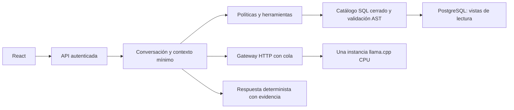

# Arquitectura implementada

Una API desplegable con módulos de identidad, políticas, conversación, operaciones, analítica, acceso a datos, inferencia, respuestas y auditoría. Los imports entre módulos pasan por `public.py` o contratos; `bootstrap.py` compone adaptadores. El frontend y la API comparten origen mediante proxy. Solo `data_access/infrastructure.py` importa el driver SQL de negocio.

La identidad procede de configuración confiable del servidor. El modelo propone intención/filtros y no concede permisos. El backend comprueba permiso por operación y alcance interno global antes de consultar; `data_access` repite la autorización. Las vistas no publican PII y el login no accede a tablas originales, no es dueño, superusuario ni BYPASSRLS. El GUC transaccional de alcance ayuda a evitar errores de configuración, no autentica un usuario SQL.

SQL procede de plantillas exactas parametrizadas, incluso para agregaciones por dimensiones permitidas. No existe una ruta de ejecución de SQL generado por el modelo. Se usa AST para comprobar el catálogo y una transacción explícita de lectura con tiempo/filas/bytes acotados. Los filtros propuestos deben aparecer en el mensaje o contexto previamente confirmado; las fechas analíticas requieren límites explícitos y válidos. No se atribuyen causas ni se infieren estados de negocio.

Una llamada al modelo interpreta. Un renderizador español compone la evidencia sin otra llamada. SSE entrega progreso inmediatamente, y fragmenta la respuesta factual solo después de tener resultados autorizados. Cancelación cancela tarea, HTTP y lectura asíncrona. La cancelación SQL se prueba con un bloqueo real sobre la base ficticia y se verifica que el pool siga utilizable.

Las conversaciones están aisladas por identidad y se guardan en SQLite privado con mensajes, resultados y contexto confirmado. El UUID del chat identifica su URL `/c/{id}`; el acceso exige autenticación y permisos vigentes. El TTL solo elimina caché en memoria, no historial. Un reinicio conserva chats, pero reinicia métricas y solicitudes en curso. Se ejecuta un solo worker. Auditoría JSON conserva identificación interna autorizada, operación, versión del modelo, estado y duración, sin prompts, códigos ni filas. Ver [historial persistente](saved-chats.md).

El servidor de inferencia usa una compilación Windows CPU fijada y verificada; el manifiesto incluye SHA-256 del modelo, revisión, cuantización y licencia. Sin proyector visual, sin GPU, 4096 tokens, una generación, cuatro hilos iniciales. El 2B es candidato provisional; el plan exige comparar modelos y revisar preguntas con negocio antes de seleccionar definitivamente.
